<!-- kind: plan -->
# Ternary compute: the long-horizon capability DAG

Standing: **PROPOSED**. This is a research and coordination plan, not evidence that
the proposed engine, speedups, learning rules, or fleet already work.

The goal is to determine whether exact ternary semantics, packed execution, and
explicit learning updates can form a useful training/inference engine on ordinary
hardware. Distribute workloads after they demonstrate value. Let learned circuits
compete, but require independent correctness evidence before replacing exact code.

The ambition has two independently valuable endpoints:

- **Engineering:** a reproducible, useful training/inference worker appliance,
  operating on qualified jobs with measured costs and recovery behavior.
- **Science:** a reproducible answer about when discrete learning or grokking
  produces generalization and executable circuits beyond competitive baselines.

Neither endpoint proves the other. A faster kernel does not establish better
learning; a generalizing model does not establish an exact or faster circuit.

The [two-node preflight](../research/compute-preflight/README.md) is a bounded
preparation track, not an admission receipt for these units. Permission to wire
and bench-test two machines is not H24's qualified distributed-pilot capability.
Controller-only probes never satisfy H14's actual-target requirement.

## Start here

From the `tryte-vm` repository root:

```text
node tools/compute-horizon.js --check
node tools/compute-horizon.js --ready
node tools/compute-horizon.js --node H02
node tools/compute-horizon.js --contract H02
```

Read [AGENTS.md](../AGENTS.md) before doing any work, then this document and the
selected unit's complete card. `--node` returns a portable JSON work packet.
`--ready` is an advisory view, not a job launch, resource allocation, or exclusive
claim. Initial research work has not been started by creating this roadmap.

[compute-horizon.json](compute-horizon.json) owns unit definitions, dependencies,
claims and attempt references. The generated section below is a projection of that
file. Edit the JSON, then run:

```text
node tools/compute-horizon.js --render
node tools/compute-horizon.js --check
node tools/compute-horizon.js --self-test
node test/test-design.js
```

The renderer changes only the marked generated section. The dedicated horizon
checks are **not yet part of `npm test`**; run them explicitly when changing this
roadmap or its checker. Existing repository tests remain applicable. This planning
tool is not an empirical audit and does not add findings to `FINDINGS.json`.

The preflight review removes two unnecessary serial dependencies: H11 integration
and H19 known-circuit lowering may qualify a pinned, correct backend before H10
performance selection. H14 still requires H10 for a positive deployment capability.
No existing attempt was reclassified; the graph still starts without admitted
attempts. These are changes to proposed contracts, not newly earned capabilities.

## One thing, seen as either a node or an edge

The single record type is a **work/capability transition**. It consumes named
prerequisite outputs and offers new outputs under explicit acceptance conditions.

For example, H08 consumes the qualified oracle and the representation contract.
It can produce a report and, if its checks hold, a qualified packed backend.

- In the dependency view, **H08 is a node** that a model can own and work on.
- In the capability view, **H08 is a directed transition**, or hyperedge, from its
  prerequisite capabilities to its outputs.
- The displayed arrows come directly from `requires`. There is no second edge
  table to maintain and no hidden dependency expressed only in a diagram.

This is a deliberate two-view representation, not a claim that an ordinary
mathematical graph's vertices and edges are literally identical. If a dependency
itself needs research, give that question its own transition record.

The structure is a DAG rather than a strict tree because multiple branches share
prerequisites and later join. A runtime learning loop may be the subject of a
unit; it does not introduce a cycle into the research dependency graph. A new
research iteration gets a successor unit or a new versioned attempt.

## What is built

The repository contains the JavaScript VM, arithmetic, tests, and an existing
findings ledger. Entry points are linked in the graph's source map. Their existence
does not grant any new neural, packed-runtime, or distributed capability here.
H00 owns the live version/provenance inventory and decides which existing results
can be reused under their actual scope.

The existing [switch-level roadmap](12-roadmap.md) remains a separate project.
This roadmap does not reinterpret device-model switch counts as CPU timings,
physical thermodynamics, or hardware proof. Likewise, the sibling grokking journal
and skill tree keep their scientific history; this file indexes cross-repository
dependencies rather than replacing those records.

## What is missing

The graph starts without admitted attempts. In particular, it does not assume:

- A native packed backend, a tensor interface, or a qualified neural accumulator.
- Useful model quality with both ternary weights and ternary activations.
- A shared learning/inference implementation, or wholly ternary learning state.
- A learned circuit that is both exactly qualified and faster after lowering.
- An inventoried, installed, authenticated or benchmarked worker fleet.

The reported mini PCs are a target platform. Physical access, exact hardware,
thermal behavior, NIC speeds, and deployment permissions are checked when needed.
The immediate deliverable is an executable research plan; scientific and system
capabilities remain subject to their gates.

## The sequence

The initial independent assignments are the inventory, workload contract,
numerical semantics, and hardware/measurement design. Their actual readiness is
derived below, so this paragraph never substitutes for dependency checks.

After the interfaces are reviewed, separate models can own the native integer,
feature-packed, and independent-example candidates. The comparison consumes all
their **assessments**, so a failed packed candidate does not prevent selecting the
strong native baseline. A complete layer and useful-model evaluation converge at
the single-machine gate.

Learning-state semantics, circuit interfaces and the worker contract can develop
alongside those candidates once their own prerequisites are satisfied. Learning
experiments, discovery experiments and system rollout then follow their separate
gates. The custom OS is downstream of a useful pilot, not a prerequisite for the
first arithmetic result.

H27 consumes the single-machine **answer**, including a negative one, and makes a
portfolio decision before more deployment work is assumed. H28 describes the
integrated engineering endpoint. H29 describes the scientific synthesis, for which
a well-powered negative result is also valuable. Optional speculative work must
not become a hidden prerequisite for basic useful execution.

## What an unlock means

Each unit declares two output ports:

| Port | Meaning | Can a negative result produce it? |
|---|---|---|
| `assessment` | A reviewed, reproducible answer under the stated contract. | Yes. Refutation and inconclusive findings are legitimate research outputs. |
| `capability` | The unit's particular acceptance condition holds within its named scope. | No. A refuted, inconclusive or invalid attempt cannot grant it. |

All entries in `requires` are required: a join uses **AND**, not an implicit OR.
Alternative designs are sibling units. A comparison/selection unit consumes their
assessments and publishes its own scoped selection capability. An assessment of an
incorrect kernel permits discussion of that result, not deployment of the kernel.

Some units can report a valid negative answer even when they cannot produce a
positive capability. `capability_requires` names qualifications needed only for
that positive output. `capability_choices` names groups of alternatives from which
the attempt must bind at least one qualified option. The selected bindings live in
the attempt's `capability_inputs`, including exact attempt and receipt hashes.
These are still fields of the same transition record, not a separate edge store.

Thus H10 can conclude that packed candidates lost and select the native baseline.
If it selects a packed candidate instead, that candidate's later disqualification
withholds H10's capability and downstream capabilities, while preserving H10's
historical assessment. H14 can report a no-go after a failed full inference path;
H22 can report no candidate or no qualified lowering. Neither may claim unrun
measurements as evidence. Dashed graph links are positive-output qualifications;
solid links are prerequisites for undertaking the work/report itself.

The record's `kind` is a work category, not a confidence level. Research outcomes
are `supported`, `refuted`, `inconclusive`, or `invalid`. The entire design remains
`PROPOSED`; claims supported by actual work belong in the owning evidence ledger.
A supported selection or report means that selection/report met its contract,
not that every hypothesis it considered was true.

Readiness is derived; do not add manually maintained ready/unlocked flags. A unit
with all prerequisite ports available is eligible for assignment, not permission
to exceed the unit's scope or spend unallocated compute.

## Parallel ownership and handoff

Use one coordinator and several independently owned work units:

1. **Coordinator:** owns changes to the shared graph, reserves resources, records
   leases, integrates reviewed attempts, and renders this document. It must check
   current git state before integrating anything; another writer may have moved it.
2. **Worker:** owns one unit/attempt, declared write paths and a bounded allocation.
   Start in an isolated branch/worktree where practical. Unit-scoped artifact paths
   are proposed locations, not permission to modify other shared interfaces.
3. **Reviewer:** did not produce the result. Reproduce appropriate checks, challenge
   the semantic claim and verify provenance before the coordinator records ports.

A model may review one unit while another works on a disjoint unit. Different
model names or sessions are useful for independent criticism, not evidence that a
conclusion is correct. Multiple models agreeing is not a scientific instrument.

Claims contain owner, attempt ID, UTC expiry, write paths and resources. **The JSON
claim field is not an atomic lock.** The coordinator serializes claims and checks
write/resource conflicts. An expired lease is investigated and explicitly released;
it is never automatically stolen. A lost worker must not be presumed stopped.
No claim/reservation server has been implemented by this roadmap.

Workers return node-scoped artifacts and a receipt; they do not all edit the
central graph concurrently. Conflicting contract proposals get separate review
records. Preserve unrelated work. Do not commit, push, install dependencies, start
remote jobs, provision devices or alter network settings merely because a future
unit mentions them; follow the task's actual authority and owning repository rules.

### Portable dispatch prompt

```text
Work on unit <ID>, attempt <ATTEMPT>, from tryte-vm/design/13-compute-horizon.md.
Read the owning repository's AGENTS.md and authoritative handoff first.
Run the horizon checker and inspect --node <ID>. Confirm every required port,
its exact attempt/receipt, and the coordinator's lease before implementation.
Your write scope is <PATHS>; your resource allocation is <BUDGET/HOSTS>.
Other units, the central graph, and shared interfaces are read-only unless named.
State the claim, finite/proof/sampled domain, instrument and failure condition.
Follow the owning preregistration protocol before empirical comparisons.
Do only this bounded unit. Retain failures and raw evidence. Return changed paths,
source/tree hashes, commands and exit codes, scope/coverage, outcome, limitations,
candidate emitted ports and the next blocker. Do not mark your own evidence admitted.
A different reviewer and the coordinator decide whether its declared ports unlock.
```

This is a portable capability/skill tree, not an installed Codex-specific skill.
Any model with the files and required tools can follow the same contract.

## Evidence receipts and durable history

An attempt pins all of the following (see the tool's schema and `--node` output):

- Its unit contract hash, produced by `--contract ID`; producer and separate reviewer.
- Source commit and a tree/content digest covering the actual code, including relevant
  uncommitted or generated inputs. The receipt specifies the hashing procedure.
- Preregistration artifact, digest and registering commit for empirical attempts,
  plus the owning ledger/registration IDs. Check that it preceded measurement.
- Each input unit, output port, exact upstream attempt and receipt digest.
- Additional positive-output qualifications and the actual selected alternatives,
  pinned in `capability_inputs`; assessment availability alone is insufficient.
- Commands, environment, raw-result locations/digests, exit status, measured scope,
  coverage, budget, limitations and the reported outcome.
- The result receipt's path/digest and the ports being offered for admission.

The graph stores compact references. Raw data and reasoning stay in the owning
attempt directory and authoritative findings/journal; do not duplicate their
numbers throughout the roadmap. The `commands`, `coverage` and `limitations`
fields summarize those receipts rather than replacing them.

Attempts are append-only **by coordinator discipline**. This version of the checker
validates only the current snapshot; it cannot detect an attempt deleted or rewritten
in history. Review the diff against the previous accepted graph and immutable
receipt references before integrating a change. Protecting that history mechanically
against a prior trusted snapshot is a future tooling improvement, not a feature
already present.

Contract edits make older attempts stale for current unlocks, while retaining them
as history. Downstream input receipt pins are checked transitively. Conflicting
current supported/refuted results withhold the capability pending review. Keep a
unit's kind stable; a kind change needs a new unit ID. Preserve old units that
historical attempts reference.

A revision must include an explicit resolution note identifying the old claim,
its defect or narrowed scope, and the successor. Reference that note from the new
contract or receipt. Merely changing words or rehashing a contract is not a
resolution of contradictory evidence. Do not silently remove a failed dependency
to obtain a green readiness view.

## What the checker does and does not establish

The checker validates record shape, IDs, dependency references, cycles, output
names, attempt metadata, current contract hashes, exact input bindings, transitive
availability (including selected qualification inputs), contradictory current
outcomes, claims, and generated-document
freshness. Its self-tests exercise healthy cases and malformed/incorrect graph
mutations through the same production code, including the CLI path.

It **does not** verify receipt files against their declared hashes, inspect git
ancestry, enforce historical append-only behavior, reserve resources, prove reviewer
independence, validate experimental statistics, or certify scientific conclusions.
An `assessment`/`capability` in its output means **recorded as qualified under this
metadata**, not independently proved by this tool. Metadata validation is useful
coordination plumbing; it is not a substitute for the reviewer or the instrument.

For empirical work, this repository's pre-registration and findings requirements
still apply. Uncommitted planning text is not durable preregistration. If the
required registration/commit authority or compute allocation is missing, stop at
that boundary and report it rather than running first and documenting later.

## What would stop it

- A correct packed kernel loses to a competent native baseline after total costs.
- Strict ternary activations lose too much quality for the chosen useful task.
- Learning-state or update cost erases an inference-side advantage.
- A discovered circuit generalizes only on samples or lowers to slower execution.
- Networking, controller work or recovery costs erase the single-node benefit.
- An instrument cannot discriminate the preferred claim from its control.
- A required device, dataset, permission, budget or independent review is unavailable.

Each failure stops the affected claim/branch, not every unrelated research lane.
Create a separately justified successor experiment if a different mechanism is
worth testing. More effort on the same unresolved obligation is not automatically
progress; compare what was predicted with the actual halt and name the mechanism.

## What this plan does not decide

- It does not choose final model architecture, dataset, thresholds, compiler or
  learning rule before their design units compare alternatives.
- It grants no new public service, transport replacement, VM API access or authority
  for destructive installation. A future aethor integration needs its own scope.
- It does not assume CPU-only or GPU superiority. A GPU backend can become a sibling
  candidate after an appropriate workload, reference and measurement contract exist.
- It does not require all-ternary learning state, a new operating-system kernel,
  or a fleet-wide synchronous training algorithm.
- It makes no reversible-CMOS, Landauer-limit, no-throttling, GBS, GKP or quantum
  speedup claim. Quantum hardware research is a separate program with its own
  physical resources and evidence; classical bit packing grants none of it.
- It does not establish novelty. The scientific synthesis must inspect current
  primary prior art and competitive alternatives before making a frontier claim.

## What is missing from this list

This is an initial decomposition, not a complete map of possible research. Propose
new units when evidence identifies a missing bottleneck or capability. Give each
one an explicit question, prerequisite ports, acceptance test, falsifier,
alternatives, write scope and resource limit. Avoid making speculative branches
prerequisites for an already testable question.

Future tooling candidates include history-diff enforcement, atomic claims,
resource-conflict checks, artifact-hash verification and an interactive graph view.
They are not needed to start the bounded design units, and none is silently claimed
as implemented here.

## Generated skill tree and work cards

Do not hand-edit the region below. It is derived from `compute-horizon.json`.

<!-- horizon:generated:start -->
## Generated work frontier

This region is generated from `compute-horizon.json`. Readiness is advisory and depends on the ordinary work-input AND-join. Capability qualification additionally requires all fixed qualification inputs and pinned selections covering every choice group.

Ready, unclaimed units: `H00`, `H01`, `H02`, `H03`.

A finished assessment does not imply a capability. Expired claims remain claimed until a coordinator releases them. No worker has been launched by this document.

Direct consumers and reachable endpoints are derived from all planned dependencies, including possible choices, not promises of successful work. Solid arrows are work inputs; dashed arrows are capability-only qualifications. A terminal unit has no consumers and includes itself in its reachable endpoints.

### Dependency DAG

```mermaid
flowchart TD
  H00["H00: Inventory the actual starting point"]
  H01["H01: Freeze workloads, comparisons, and stopping rules"]
  H02["H02: Specify numerical and state semantics"]
  H03["H03: Design target-machine and physical-network measurement"]
  H04["H04: Qualify an independent exact scalar oracle"]
  H05["H05: Define a portable packed operator interface"]
  H06["H06: Build a correctness-first measurement harness"]
  H07["H07: Build the strong native integer baseline"]
  H08["H08: Build the feature-packed candidate"]
  H09["H09: Build the independent-example bit-sliced candidate"]
  H10["H10: Measure and select layouts without assuming a packed winner"]
  H11["H11: Execute a complete layer and model path"]
  H12["H12: Test useful model quality independently of speed"]
  H13["H13: Qualify the exact candidate-admission boundary"]
  H14["H14: Single-mini-PC useful-computation gate"]
  H15["H15: Define one runtime for prediction and learning"]
  H16["H16: Demonstrate learning in the shared runtime"]
  H17["H17: Test the fully discrete learning hypothesis"]
  H18["H18: Specify typed circuits as executable artifacts"]
  H19["H19: Lower known circuits before learned circuits"]
  H20["H20: Preregister the grokking-to-circuit question"]
  H21["H21: Run the bounded discovery campaign"]
  H22["H22: Admit and benchmark discovered circuits"]
  H23["H23: Specify bounded distributed jobs and result acceptance"]
  H24["H24: Qualify a two-node pilot"]
  H25["H25: Qualify the worker appliance and recovery path"]
  H26["H26: Measure fleet scaling before declaring a mesh advantage"]
  H27["H27: Make the first portfolio decision"]
  H28["H28: Integrate the useful training/inference appliance"]
  H29["H29: Synthesize the scientific frontier claim"]
  H00 -->|capability| H04
  H02 -->|capability| H04
  H02 -->|capability| H05
  H01 -->|capability| H06
  H03 -->|capability| H06
  H04 -->|capability| H06
  H04 -->|capability| H07
  H05 -->|capability| H07
  H04 -->|capability| H08
  H05 -->|capability| H08
  H04 -->|capability| H09
  H05 -->|capability| H09
  H06 -->|capability| H10
  H07 -->|capability| H10
  H08 -->|assessment| H10
  H09 -->|assessment| H10
  H07 -.->|choice: selected_backends| H10
  H08 -.->|choice: selected_backends| H10
  H09 -.->|choice: selected_backends| H10
  H02 -->|capability| H11
  H05 -->|capability| H11
  H04 -->|capability| H11
  H07 -.->|choice: qualified_integration_backend| H11
  H08 -.->|choice: qualified_integration_backend| H11
  H09 -.->|choice: qualified_integration_backend| H11
  H00 -->|capability| H12
  H01 -->|capability| H12
  H04 -->|capability| H12
  H04 -->|capability| H13
  H05 -->|capability| H13
  H03 -->|capability| H14
  H06 -->|capability| H14
  H11 -->|assessment| H14
  H12 -->|assessment| H14
  H13 -->|capability| H14
  H10 -.->|capability-all| H14
  H11 -.->|capability-all| H14
  H12 -.->|capability-all| H14
  H01 -->|capability| H15
  H02 -->|capability| H15
  H04 -->|capability| H15
  H06 -->|capability| H16
  H11 -->|capability| H16
  H12 -->|assessment| H16
  H15 -->|capability| H16
  H06 -->|capability| H17
  H15 -->|capability| H17
  H16 -->|assessment| H17
  H02 -->|capability| H18
  H04 -->|capability| H18
  H05 -->|capability| H18
  H13 -->|capability| H19
  H18 -->|capability| H19
  H07 -.->|choice: qualified_lowering_backend| H19
  H08 -.->|choice: qualified_lowering_backend| H19
  H09 -.->|choice: qualified_lowering_backend| H19
  H00 -->|capability| H20
  H01 -->|capability| H20
  H06 -->|capability| H20
  H18 -->|capability| H20
  H19 -->|assessment| H20
  H20 -->|capability| H21
  H06 -->|capability| H22
  H13 -->|capability| H22
  H19 -->|assessment| H22
  H21 -->|assessment| H22
  H19 -.->|capability-all| H22
  H21 -.->|capability-all| H22
  H03 -->|capability| H23
  H05 -->|capability| H23
  H13 -->|capability| H23
  H14 -->|capability| H24
  H23 -->|capability| H24
  H24 -->|capability| H25
  H24 -->|capability| H26
  H25 -->|capability| H26
  H14 -->|assessment| H27
  H13 -->|capability| H28
  H16 -->|capability| H28
  H23 -->|capability| H28
  H26 -->|capability| H28
  H17 -->|assessment| H29
  H21 -->|assessment| H29
  H22 -->|assessment| H29
```



### Unit index

| Unit | Transition / skill | Lane | Work inputs (all; qualification in card) | State |
|---|---|---|---|---|
| [H00](#h00) | Inventory the actual starting point | Foundations | none | ready |
| [H01](#h01) | Freeze workloads, comparisons, and stopping rules | Foundations | none | ready |
| [H02](#h02) | Specify numerical and state semantics | Foundations | none | ready |
| [H03](#h03) | Design target-machine and physical-network measurement | Systems | none | ready |
| [H04](#h04) | Qualify an independent exact scalar oracle | Exact execution | H00:capability, H02:capability | blocked |
| [H05](#h05) | Define a portable packed operator interface | Exact execution | H02:capability | blocked |
| [H06](#h06) | Build a correctness-first measurement harness | Measurement | H01:capability, H03:capability, H04:capability | blocked |
| [H07](#h07) | Build the strong native integer baseline | CPU candidates | H04:capability, H05:capability | blocked |
| [H08](#h08) | Build the feature-packed candidate | CPU candidates | H04:capability, H05:capability | blocked |
| [H09](#h09) | Build the independent-example bit-sliced candidate | CPU candidates | H04:capability, H05:capability | blocked |
| [H10](#h10) | Measure and select layouts without assuming a packed winner | Measurement | H06:capability, H07:capability, H08:assessment, H09:assessment | blocked |
| [H11](#h11) | Execute a complete layer and model path | Exact execution | H02:capability, H05:capability, H04:capability | blocked |
| [H12](#h12) | Test useful model quality independently of speed | Learning | H00:capability, H01:capability, H04:capability | blocked |
| [H13](#h13) | Qualify the exact candidate-admission boundary | Assurance | H04:capability, H05:capability | blocked |
| [H14](#h14) | Single-mini-PC useful-computation gate | Decision gates | H03:capability, H06:capability, H11:assessment, H12:assessment, H13:capability | blocked |
| [H15](#h15) | Define one runtime for prediction and learning | Learning | H01:capability, H02:capability, H04:capability | blocked |
| [H16](#h16) | Demonstrate learning in the shared runtime | Learning | H06:capability, H11:capability, H12:assessment, H15:capability | blocked |
| [H17](#h17) | Test the fully discrete learning hypothesis | Learning | H06:capability, H15:capability, H16:assessment | blocked |
| [H18](#h18) | Specify typed circuits as executable artifacts | Discovery | H02:capability, H04:capability, H05:capability | blocked |
| [H19](#h19) | Lower known circuits before learned circuits | Discovery | H13:capability, H18:capability | blocked |
| [H20](#h20) | Preregister the grokking-to-circuit question | Discovery | H00:capability, H01:capability, H06:capability, H18:capability, H19:assessment | blocked |
| [H21](#h21) | Run the bounded discovery campaign | Discovery | H20:capability | blocked |
| [H22](#h22) | Admit and benchmark discovered circuits | Discovery | H06:capability, H13:capability, H19:assessment, H21:assessment | blocked |
| [H23](#h23) | Specify bounded distributed jobs and result acceptance | Systems | H03:capability, H05:capability, H13:capability | blocked |
| [H24](#h24) | Qualify a two-node pilot | Systems | H14:capability, H23:capability | blocked |
| [H25](#h25) | Qualify the worker appliance and recovery path | Systems | H24:capability | blocked |
| [H26](#h26) | Measure fleet scaling before declaring a mesh advantage | Systems | H24:capability, H25:capability | blocked |
| [H27](#h27) | Make the first portfolio decision | Decision gates | H14:assessment | blocked |
| [H28](#h28) | Integrate the useful training/inference appliance | Decision gates | H13:capability, H16:capability, H23:capability, H26:capability | blocked |
| [H29](#h29) | Synthesize the scientific frontier claim | Decision gates | H17:assessment, H21:assessment, H22:assessment | blocked |

### Portable work cards

<a id="h00"></a>

#### H00 — Inventory the actual starting point

- Lane / kind: Foundations / `specification`.
- Question: Which implementation, evidence, and hardware assets exist now, and which claims are only proposals?
- Work inputs (all): none.
- Capability-only fixed inputs (all): none.
- Capability-only choices (select one or more per group): none.
- Direct consumers: `H04` via `capability` (work), `H12` via `capability` (work), `H20` via `capability` (work).
- Reachable endpoints: `H27`, `H28`, `H29`.
- Assessment output: A version-pinned inventory with inaccessible or unverified assets explicitly named.
- Capability output: A reviewed source map and reuse boundary sufficient to identify the exact reference implementation and applicable research protocols.
- State: `ready`; attempts recorded: 0.
- Contract SHA-256: `3959dc3d819828ef84a467a943fff06253e194984822a5f3f80c7a3001c410a5`.

Acceptance:

- Record repository commits, dirty-tree/file hashes, relevant tests and their actual run status; distinguish code inspection from runtime evidence.
- Read the sibling grokking handoff, journal, system, and relevant skill-tree entries; distinguish committed results, ignored raw data, and narrative claims.
- Identify existing VM neural-task benchmarks and any related aethor transport work without adopting its security claims or changing that repository.
- Record the mini-PC fleet as user-reported until individually inventoried; no network discovery outside explicitly supplied machines.

Falsifier: An asset is treated as implemented or revalidated when only prose, an old run, or an unavailable file supports it.

Alternatives:

- Reuse a qualified existing artifact with a pinned scope.
- Reproduce a missing qualification locally.
- Leave an inaccessible claim unverified and exclude it from downstream assumptions.

Scope:

- Repository: `tryte-vm; sibling repositories read-only`.
- Write root: `research/compute-horizon/H00/`.
- Resources: Local read-only inventory and bounded existing checks; no remote jobs.

Portable dispatch: `node tools/compute-horizon.js --node H00`.

<a id="h01"></a>

#### H01 — Freeze workloads, comparisons, and stopping rules

- Lane / kind: Foundations / `specification`.
- Question: What useful result would justify this engine, and what comparison could reject it?
- Work inputs (all): none.
- Capability-only fixed inputs (all): none.
- Capability-only choices (select one or more per group): none.
- Direct consumers: `H06` via `capability` (work), `H12` via `capability` (work), `H15` via `capability` (work), `H20` via `capability` (work).
- Reachable endpoints: `H27`, `H28`, `H29`.
- Assessment output: An explicit workload and comparison design, including objections.
- Capability output: A reviewed evaluation contract naming task quality, latency/throughput, memory, budgets, uncertainty, and stopping criteria before measurement.
- State: `ready`; attempts recorded: 0.
- Contract SHA-256: `e1f3eeb11fa48ae1799123732cdbfbe29a509a1bea96a8c5790c56db6b2441dd`.

Acceptance:

- Select a bounded algebraic/generalization task and a practical inference task with accessible data, fixed splits, and justified quality tolerances.
- Compare against a competent conventional model and optimized integer implementation, not only the JavaScript interpreter or FP32 storage arithmetic.
- Separate weight-only ternary models from models with ternary activations; account for wider accumulators, scaling, normalization, and learning state.
- Freeze shape and batch sweeps, seeds, repetition and uncertainty policy, end-to-end cost boundary, and a minimum worthwhile gain; obtain user input only for material use-case, budget, or data choices that remain unresolved.

Falsifier: The criteria can be changed after seeing results, omit a strong baseline, or cannot distinguish useful improvement from measurement noise.

Alternatives:

- Small classifier or sequence model.
- Exact algebraic/circuit tasks with held-out structure.
- Reject a proposed workload if data access or the required quality cannot be assessed.

Scope:

- Repository: `tryte-vm`.
- Write root: `research/compute-horizon/H01/`.
- Resources: Design and source research only; training budgets are not granted by this unit.

Portable dispatch: `node tools/compute-horizon.js --node H01`.

<a id="h02"></a>

#### H02 — Specify numerical and state semantics

- Lane / kind: Foundations / `specification`.
- Question: What exactly must every backend compute, including the cases a ternary label hides?
- Work inputs (all): none.
- Capability-only fixed inputs (all): none.
- Capability-only choices (select one or more per group): none.
- Direct consumers: `H04` via `capability` (work), `H05` via `capability` (work), `H11` via `capability` (work), `H15` via `capability` (work), `H18` via `capability` (work).
- Reachable endpoints: `H27`, `H28`, `H29`.
- Assessment output: An arithmetic/state design and an explicit list of incompatible alternatives.
- Capability output: A reviewed versioned contract for trits, wide accumulators, overflow, rounding, thresholds, bias, reset, and deterministic state transitions.
- State: `ready`; attempts recorded: 0.
- Contract SHA-256: `100df1d5e9a729f58581fe995c4dd5df817d5a4a40825803910075541fc5ce07`.

Acceptance:

- Define valid trits and dual-rail encoding, reject the invalid rail combination, and specify empty dimensions, padding and malformed inputs.
- Derive accumulator ranges from shapes and bias bounds; choose explicit overflow behavior and account for values beyond a VM tryte.
- Distinguish a scalar ternary value, a multi-trit integer, and a tensor element; do not substitute tritwise CSUM for an unrestricted dot product.
- Declare which operations existing VM instructions implement and which require multiword code or a separate typed extension; preserve existing VM behavior.

Falsifier: Two conforming backends could disagree because an overflow, tie, threshold, precision, or state-boundary rule is unspecified.

Alternatives:

- Fixed-width integer accumulators with checked bounds.
- Multiword balanced-ternary accumulation.
- Explicit saturating arithmetic as a different, versioned operator contract.

Scope:

- Repository: `tryte-vm`.
- Write root: `research/compute-horizon/H02/`.
- Resources: Specification and hand-checkable examples; no ISA change implicitly authorized.

Portable dispatch: `node tools/compute-horizon.js --node H02`.

<a id="h03"></a>

#### H03 — Design target-machine and physical-network measurement

- Lane / kind: Systems / `specification`.
- Question: How will measurements on the actual mini PCs and their offline links be made comparable and safe?
- Work inputs (all): none.
- Capability-only fixed inputs (all): none.
- Capability-only choices (select one or more per group): none.
- Direct consumers: `H06` via `capability` (work), `H14` via `capability` (work), `H23` via `capability` (work).
- Reachable endpoints: `H27`, `H28`, `H29`.
- Assessment output: A hardware inventory template, wiring plan, and measurement limitations.
- Capability output: A reviewed procedure for identifying the execution host, CPU features, core topology, NICs, storage, thermals, and available power instrumentation.
- State: `ready`; attempts recorded: 0.
- Contract SHA-256: `7bda6f797dd6d47a4e8b9660feb9ae4724cfc7d26c10132bc11950a246f742c5`.

Acceptance:

- Treat the reported Ryzen fleet and RAM as an inventory target, not confirmed identical machines; record CPUID/features, firmware, OS, memory and NIC details when access exists.
- Plan a dedicated Ethernet switch and controller interface; specify addressing and intentional absence of Internet routing or bridging. Offline Ethernet is still a network.
- Distinguish physical cores and SMT siblings; prepare single-core, physical-core and SMT comparisons without assuming scaling.
- Define warmup, sustained duration, affinity, frequency/thermal reporting, and whether energy comes from a wall meter, package estimate, or is unavailable; do not infer joules from gate counts.

Falsifier: A timing lacks its actual host/thermal context, or a network isolation or energy claim exceeds what the proposed instrument can observe.

Alternatives:

- Existing minimal Linux for the first pilot.
- Later immutable appliance if operational measurements justify it.
- Single-node operation while physical access or network details are unresolved.

Scope:

- Repository: `tryte-vm`.
- Write root: `research/compute-horizon/H03/`.
- Resources: Inventory/wiring instructions only; no disk flashing, interface reconfiguration, or remote access.

Portable dispatch: `node tools/compute-horizon.js --node H03`.

<a id="h04"></a>

#### H04 — Qualify an independent exact scalar oracle

- Lane / kind: Exact execution / `implementation`.
- Question: Can a simple independent implementation expose mistakes shared by the VM and optimized kernels?
- Work inputs (all): `H00:capability`, `H02:capability`.
- Capability-only fixed inputs (all): none.
- Capability-only choices (select one or more per group): none.
- Direct consumers: `H06` via `capability` (work), `H07` via `capability` (work), `H08` via `capability` (work), `H09` via `capability` (work), `H11` via `capability` (work), `H12` via `capability` (work), `H13` via `capability` (work), `H15` via `capability` (work), `H18` via `capability` (work).
- Reachable endpoints: `H27`, `H28`, `H29`.
- Assessment output: A reproducible correctness report, including counterexamples.
- Capability output: A qualified exact scalar oracle on a declared domain, with powered checks and an explicit VM compatibility boundary.
- State: `blocked`; attempts recorded: 0.
- Contract SHA-256: `67b578fbbdad374ae3bf47489d436edf8420ec74812fb9e3dfb87786f9bb92f2`.

Acceptance:

- Check the complete scalar product truth table, hand-derived edge cases, and an exhaustively enumerated small-vector domain.
- Use an independently formulated reduction rather than copying the packed equations into both subject and oracle.
- Compare applicable operations against the current VM, including multiword or overflow refusal behavior.
- Break the implementation deliberately in isolated test fixtures and require checks to detect sign, zero, carry, threshold and overflow defects; report sampled versus exhaustive coverage.

Falsifier: A mismatch, an untested arithmetic boundary, or a deliberate implementation mutation that the check fails to detect.

Alternatives:

- BigInt exact reference for bounded tests.
- Range-proved integer reference.
- Independent multi-trit interpreter with explicit state bounds.

Scope:

- Repository: `tryte-vm`.
- Write root: `research/compute-horizon/H04/`.
- Resources: Bounded local correctness tests; no throughput conclusion.

Portable dispatch: `node tools/compute-horizon.js --node H04`.

<a id="h05"></a>

#### H05 — Define a portable packed operator interface

- Lane / kind: Exact execution / `specification`.
- Question: Can independently written backends consume the same unambiguous jobs and data?
- Work inputs (all): `H02:capability`.
- Capability-only fixed inputs (all): none.
- Capability-only choices (select one or more per group): none.
- Direct consumers: `H07` via `capability` (work), `H08` via `capability` (work), `H09` via `capability` (work), `H11` via `capability` (work), `H13` via `capability` (work), `H18` via `capability` (work), `H23` via `capability` (work).
- Reachable endpoints: `H27`, `H28`, `H29`.
- Assessment output: A representation/interface proposal and compatibility tests.
- Capability output: A frozen operator and serialization contract with fixtures, validation rules, layout identifiers and resource limits.
- State: `blocked`; attempts recorded: 0.
- Contract SHA-256: `2c14470c9808624e6f82aec589de27e2a31206435d805f944fabad12bfb1144c`.

Acceptance:

- Specify element order, rail order, byte order, shapes, lengths, alignment assumptions, tail masks and canonical serialization.
- Distinguish feature-packed reduction from independent-example bit lanes; no lane-count calculation may count both at once.
- Name tensor, circuit and VM boundaries, versioning, deterministic seeds where applicable, and maximum input/output sizes.
- Provide scalar fixtures, round-trip checks, and malformed-input refusal cases that both native and JavaScript implementations can consume.

Falsifier: A producer and consumer can interpret the same byte string differently or accept an invalid rail, shape or tail.

Alternatives:

- Dual-rail masks.
- Byte-per-trit interchange with packing internal to a backend.
- Separate versioned formats where a single format imposes excessive conversion cost.

Scope:

- Repository: `tryte-vm`.
- Write root: `research/compute-horizon/H05/`.
- Resources: Local contract fixtures; interface integration requires the owner of affected files.

Portable dispatch: `node tools/compute-horizon.js --node H05`.

<a id="h06"></a>

#### H06 — Build a correctness-first measurement harness

- Lane / kind: Measurement / `implementation`.
- Question: Can the harness distinguish arithmetic correctness, kernel speed, and useful end-to-end improvement?
- Work inputs (all): `H01:capability`, `H03:capability`, `H04:capability`.
- Capability-only fixed inputs (all): none.
- Capability-only choices (select one or more per group): none.
- Direct consumers: `H10` via `capability` (work), `H14` via `capability` (work), `H16` via `capability` (work), `H17` via `capability` (work), `H20` via `capability` (work), `H22` via `capability` (work).
- Reachable endpoints: `H27`, `H28`, `H29`.
- Assessment output: A harness qualification report and identified blind spots.
- Capability output: A reproducible harness whose controls detect wrong answers and whose measurements retain raw distributions and complete cost boundaries.
- State: `blocked`; attempts recorded: 0.
- Contract SHA-256: `ec42f62e908c651538412796908264ebc4b062b964895a23fbabef4af8c9ed26`.

Acceptance:

- Refuse performance qualification when correctness checks fail; retain compiler options, source hashes, host identity and run order.
- Report prepacked kernel timings separately from packing, allocation, dispatch, reduction, activation and serialization-inclusive timings.
- Test that a deliberately wrong implementation fails and that meaningful extra work changes the measured quantity; include healthy controls.
- Support matched randomized run order, warmup, sustained tests, uncertainty, resource caps and explicit unavailable metrics; preregister comparative claims before measuring them.

Falsifier: The harness can report a win for wrong arithmetic, unaccounted work, a dead-code-eliminated computation, or a difference within unresolved noise.

Alternatives:

- In-process native measurements with consumed checksums.
- Whole-job subprocess measurements.
- Separate kernel and service-level instruments with a shared provenance record.

Scope:

- Repository: `tryte-vm`.
- Write root: `research/compute-horizon/H06/`.
- Resources: Bounded local instrument tests; target-machine campaigns need a separate registration and resource allocation.

Portable dispatch: `node tools/compute-horizon.js --node H06`.

<a id="h07"></a>

#### H07 — Build the strong native integer baseline

- Lane / kind: CPU candidates / `implementation`.
- Question: How much can ordinary compiled arithmetic achieve before attributing any benefit to bit slicing?
- Work inputs (all): `H04:capability`, `H05:capability`.
- Capability-only fixed inputs (all): none.
- Capability-only choices (select one or more per group): none.
- Direct consumers: `H10` via `capability` (work), `H10` via `capability` (capability-choice: selected_backends), `H11` via `capability` (capability-choice: qualified_integration_backend), `H19` via `capability` (capability-choice: qualified_lowering_backend).
- Reachable endpoints: `H27`, `H28`, `H29`.
- Assessment output: A baseline implementation and correctness review, including failures.
- Capability output: An exact native integer backend with documented compiler/vectorization choices and identical operator semantics.
- State: `blocked`; attempts recorded: 0.
- Contract SHA-256: `0015afcc46bcf1fea1a8e64af1391a6d19c62fb9a6070dace0b5a75152bd579f`.

Acceptance:

- Implement the complete declared operator using appropriate integer arithmetic, avoiding deliberately weak scalar code when compiler vectorization is available.
- Match the oracle and malformed-input behavior on the declared qualification domain.
- Separate interpreter overhead from representation effects; record wider accumulator and conversion costs.
- Expose the same backend interface and output fixtures used by packed candidates.

Falsifier: The baseline is incorrect or handicapped in a way that makes a representation comparison misleading.

Alternatives:

- Compiler-vectorized byte/integer arithmetic.
- Explicit ordinary SIMD where justified.
- A suitable existing native kernel with compatible semantics and dependency approval.

Scope:

- Repository: `tryte-vm`.
- Write root: `research/compute-horizon/H07/`.
- Resources: Local compilation and correctness tests; no dependency installation assumed.

Portable dispatch: `node tools/compute-horizon.js --node H07`.

<a id="h08"></a>

#### H08 — Build the feature-packed candidate

- Lane / kind: CPU candidates / `implementation`.
- Question: Can rail logic plus reductions implement the operator efficiently when bits index features?
- Work inputs (all): `H04:capability`, `H05:capability`.
- Capability-only fixed inputs (all): none.
- Capability-only choices (select one or more per group): none.
- Direct consumers: `H10` via `assessment` (work), `H10` via `capability` (capability-choice: selected_backends), `H11` via `capability` (capability-choice: qualified_integration_backend), `H19` via `capability` (capability-choice: qualified_lowering_backend).
- Reachable endpoints: `H27`, `H28`, `H29`.
- Assessment output: A candidate and correctness/cost limitations, even if unsuitable.
- Capability output: A qualified feature-packed backend on its declared CPU feature set and shape domain.
- State: `blocked`; attempts recorded: 0.
- Contract SHA-256: `c19e9724d4cac485d5d11c641b9694c1ab524370ee6e638a67a21e6f734eedd3`.

Acceptance:

- Implement positive and negative product masks with exact counts and wide accumulation.
- Cover invalid rails, partial words, zero dimensions, extreme signs, long reductions and output thresholds.
- Offer a portable word path and only supported instruction paths; AVX2 population counting needs an explicit implementation choice.
- Report register pressure, conversion and reduction work rather than equating packed values with completed neurons.

Falsifier: A mismatch, wrong tail count, silent accumulator overflow, unsupported instruction path, or unsupported constant-time whole-layer claim.

Alternatives:

- Scalar machine-word population counts.
- AVX2 vectorized counting/reduction.
- Ordinary integer arithmetic when packing costs dominate.

Scope:

- Repository: `tryte-vm`.
- Write root: `research/compute-horizon/H08/`.
- Resources: Local compilation and correctness tests; target timings belong to H10.

Portable dispatch: `node tools/compute-horizon.js --node H08`.

<a id="h09"></a>

#### H09 — Build the independent-example bit-sliced candidate

- Lane / kind: CPU candidates / `implementation`.
- Question: When each bit is a separate example, can a shared circuit beat feature-packed or ordinary integer execution?
- Work inputs (all): `H04:capability`, `H05:capability`.
- Capability-only fixed inputs (all): none.
- Capability-only choices (select one or more per group): none.
- Direct consumers: `H10` via `assessment` (work), `H10` via `capability` (capability-choice: selected_backends), `H11` via `capability` (capability-choice: qualified_integration_backend), `H19` via `capability` (capability-choice: qualified_lowering_backend).
- Reachable endpoints: `H27`, `H28`, `H29`.
- Assessment output: An independent-example layout implementation or an evidenced rejection of the candidate.
- Capability output: A qualified batch-bit-sliced backend with explicit per-example accumulator bitplanes and state separation.
- State: `blocked`; attempts recorded: 0.
- Contract SHA-256: `801eb9bcbfc0a0e3cba543715eefea496077bb0086b4cc395ad7265efb48f2a1`.

Acceptance:

- Specify how weights broadcast, state belongs to each lane, and wider per-example sums are represented.
- Check lane independence and permutation behavior against the oracle, including partial batches and inactive lanes.
- Charge transpose/packing, carry or reduction circuitry, register spills and output extraction.
- Use whole independent batches per worker; do not insert inter-core or inter-node barriers after individual gates.

Falsifier: Cross-lane contamination, an omitted accumulator plane, or a claimed throughput that omits required packing or carry work.

Alternatives:

- Boolean adder trees over bitplanes.
- Fused fixed-circuit execution for stable shapes.
- Reject this layout for divergent or too-small batches.

Scope:

- Repository: `tryte-vm`.
- Write root: `research/compute-horizon/H09/`.
- Resources: Local correctness work; independent of H08, with no shared source edits.

Portable dispatch: `node tools/compute-horizon.js --node H09`.

<a id="h10"></a>

#### H10 — Measure and select layouts without assuming a packed winner

- Lane / kind: Measurement / `experiment`.
- Question: Which qualified implementation wins for which shapes once the full operator cost is counted?
- Work inputs (all): `H06:capability`, `H07:capability`, `H08:assessment`, `H09:assessment`.
- Capability-only fixed inputs (all): none.
- Capability-only choices (select one or more per group): `selected_backends` from `H07:capability` / `H08:capability` / `H09:capability`.
- Direct consumers: `H14` via `capability` (capability-all).
- Reachable endpoints: `H27`, `H28`.
- Assessment output: A preregistered comparison with all candidates, failures, uncertainty and raw results.
- Capability output: A reviewed backend selection policy using only correctness-qualified candidates, including the native baseline when packed variants lose.
- State: `blocked`; attempts recorded: 0.
- Contract SHA-256: `e0ade4335a2e80de0b5589c3705bf7fabfb092fa2115660fb24edec3276d9f24`.

Acceptance:

- Register shape, batch, sparsity and data-residency comparisons and the decision policy before timing.
- Exclude candidates that lack actual correctness qualification; an assessment port is permission to consider the result, not permission to execute an incorrect kernel.
- Report raw and end-to-end costs, confidence/uncertainty, CPU feature dispatch and out-of-domain fallback.
- Publish negative and mixed outcomes; make a selection capability mean a valid measured choice, not a declaration that bit slicing won.

Falsifier: Selection favors an unqualified candidate, hides a losing workload, or relies on an unresolved timing difference.

Alternatives:

- One fixed backend for simplicity.
- A measured shape-dependent dispatcher.
- Keep ordinary integer execution and close the packed-speed hypothesis for this domain.

Scope:

- Repository: `tryte-vm`.
- Write root: `research/compute-horizon/H10/`.
- Resources: One registered target-CPU campaign with declared thermal and wall-time limits; no fleet rollout.

Portable dispatch: `node tools/compute-horizon.js --node H10`.

<a id="h11"></a>

#### H11 — Execute a complete layer and model path

- Lane / kind: Exact execution / `implementation`.
- Question: Does a correctness-qualified backend remain correct when products become a complete neural computation?
- Work inputs (all): `H02:capability`, `H05:capability`, `H04:capability`.
- Capability-only fixed inputs (all): none.
- Capability-only choices (select one or more per group): `qualified_integration_backend` from `H07:capability` / `H08:capability` / `H09:capability`.
- Direct consumers: `H14` via `assessment` (work), `H14` via `capability` (capability-all), `H16` via `capability` (work).
- Reachable endpoints: `H27`, `H28`, `H29`.
- Assessment output: An integration report for full layers and supported model paths.
- Capability output: An exact qualified inference path including accumulation, bias, activation, layout conversion, model loading and output interpretation.
- State: `blocked`; attempts recorded: 0.
- Contract SHA-256: `96083e1d263a241c278367d77b963425ab778dd8bff09aa8cffef2ce610acbf5`.

Acceptance:

- Compare intermediate accumulators and final outputs against the scalar contract, not only class labels.
- Account for every wider or floating auxiliary operation; describe a hybrid path honestly if one is needed.
- Bind model and operator versions, shape limits and deterministic replay fixtures, including the exact backend capability attempt selected for integration.
- Include a representative full inference path; a multiplication microbenchmark cannot satisfy this unit. Correctness integration may precede H10 performance selection; it does not substitute for that selection.

Falsifier: An intermediate mismatch, uncounted conversion, or unsupported layer silently changes model semantics.

Alternatives:

- Fully ternary-activation model with integer thresholds.
- Mixed-precision model with explicitly charged boundary operators.
- A narrowly supported model family instead of a general neural framework.

Scope:

- Repository: `tryte-vm`.
- Write root: `research/compute-horizon/H11/`.
- Resources: Bounded local model fixtures; no claims about useful quality or fleet throughput.

Portable dispatch: `node tools/compute-horizon.js --node H11`.

<a id="h12"></a>

#### H12 — Test useful model quality independently of speed

- Lane / kind: Learning / `experiment`.
- Question: Does the chosen ternary representation retain enough task quality to be worth accelerating?
- Work inputs (all): `H00:capability`, `H01:capability`, `H04:capability`.
- Capability-only fixed inputs (all): none.
- Capability-only choices (select one or more per group): none.
- Direct consumers: `H14` via `assessment` (work), `H14` via `capability` (capability-all), `H16` via `assessment` (work).
- Reachable endpoints: `H27`, `H28`, `H29`.
- Assessment output: A registered quality comparison with model/data hashes and unsuccessful seeds retained.
- Capability output: A model meeting the frozen task-quality criterion, with an explicit inference/export contract and total state inventory.
- State: `blocked`; attempts recorded: 0.
- Contract SHA-256: `dfc15b12e03e612aa5312a83dc878b181b7cdbb9dfa42b641bf2ef8c00411196`.

Acceptance:

- Compare appropriate conventional, weight-ternary and strict ternary-activation candidates under the frozen data and budget contract.
- Keep held-out evaluation separate from tuning; report uncertainty, seed spread and training compute.
- Record optimizer/shadow-weight precision, scales, normalization and accumulators instead of calling the entire training system ternary from its weights alone.
- Verify exported forward outputs on reference fixtures before handing a model to the execution lane.

Falsifier: The representation misses its quality tolerance, validation data influences selection improperly, or hidden wider state invalidates the stated comparison.

Alternatives:

- Train conventional models then evaluate quantization.
- Quantization-aware training with wider update state.
- Reject a workload where strict ternary activations are not useful.

Scope:

- Repository: `ternary-grokking for campaigns; tryte-vm for export fixtures`.
- Write root: `research/compute-horizon/H12/ in the owning repository`.
- Resources: Registered bounded training allocation only; use the owning repository's compute queue and thermal rules.

Portable dispatch: `node tools/compute-horizon.js --node H12`.

<a id="h13"></a>

#### H13 — Qualify the exact candidate-admission boundary

- Lane / kind: Assurance / `implementation`.
- Question: What independent evidence permits an optimized or learned implementation to replace an exact one?
- Work inputs (all): `H04:capability`, `H05:capability`.
- Capability-only fixed inputs (all): none.
- Capability-only choices (select one or more per group): none.
- Direct consumers: `H14` via `capability` (work), `H19` via `capability` (work), `H22` via `capability` (work), `H23` via `capability` (work), `H28` via `capability` (work).
- Reachable endpoints: `H27`, `H28`, `H29`.
- Assessment output: An admission design with powered refusal cases and scope limits.
- Capability output: An independent checker that binds a candidate, contract, declared domain and correctness evidence, rejecting missing or mismatched qualification.
- State: `blocked`; attempts recorded: 0.
- Contract SHA-256: `5a75f1a2a377dc8ec89baefc6e1e00cd14d7f1370778975d3c61d0fc813ef04f`.

Acceptance:

- Select exhaustive finite checking, an appropriate equivalence proof, or a clearly labeled sampled-only research result; sampled agreement never qualifies an unrestricted exact claim.
- Bind certificates to candidate/code hashes and arithmetic/domain versions; invalidate them when their inputs change.
- Demonstrate rejection of a wrong candidate, stale certificate, malformed shape and plausible sampled impostor on its counterexample.
- Keep learned models and candidate generators outside the authority path. A signed receipt authenticates its issuer and content, not computation correctness.

Falsifier: An incorrect, stale, out-of-domain or merely self-asserted candidate is admitted for an exact claim.

Alternatives:

- Exhaustive checking on deliberately small domains.
- SAT/SMT or other independently checked equivalence evidence for a supported circuit language.
- Research-only sampled agreement with exact replacement withheld.

Scope:

- Repository: `tryte-vm`.
- Write root: `research/compute-horizon/H13/`.
- Resources: Bounded local defensive qualification; no generic untrusted native-code execution service.

Portable dispatch: `node tools/compute-horizon.js --node H13`.

<a id="h14"></a>

#### H14 — Single-mini-PC useful-computation gate

- Lane / kind: Decision gates / `experiment`.
- Question: Does the engine deliver the predeclared useful improvement on an actual target mini PC?
- Work inputs (all): `H03:capability`, `H06:capability`, `H11:assessment`, `H12:assessment`, `H13:capability`.
- Capability-only fixed inputs (all): `H10:capability`, `H11:capability`, `H12:capability`.
- Capability-only choices (select one or more per group): none.
- Direct consumers: `H24` via `capability` (work), `H27` via `assessment` (work).
- Reachable endpoints: `H27`, `H28`.
- Assessment output: A go/no-go report tying measured quality, full inference cost, memory and sustained behavior to a named machine.
- Capability output: A useful, exactly qualified workload that meets the frozen quality and improvement criteria on the target hardware.
- State: `blocked`; attempts recorded: 0.
- Contract SHA-256: `c0091822b29b65b1d44bbd39f1e05f7d8cd7d05bb79fb124f1b3b64748534d87`.

Acceptance:

- If H11 lacks a qualified inference path or H12 misses model quality, record an evidenced no-go assessment without pretending unrun measurements occurred. A positive capability requires both qualifications to remain valid.
- Measure complete inference against the frozen strong baseline only on a qualified path, including loading/packing where the workload requires them. Bind the measured backend to H10's selection and H11's qualified path; never combine one executable's correctness with another's timing.
- Compare one core, physical-core workers and SMT workers with recorded affinity and sustained thermal behavior; report all measured crossover points.
- Claim energy improvement only with a stated instrument and boundary; otherwise leave energy open. Bind the go decision to its exact model, shapes, host and software.

Falsifier: Quality, correctness, sustained performance or the minimum worthwhile gain fails the predeclared criterion.

Alternatives:

- Proceed with the demonstrated packed route.
- Retain the ordinary integer backend and revise the acceleration hypothesis.
- Stop this deployment branch while preserving useful semantics and negative findings.

Scope:

- Repository: `tryte-vm`.
- Write root: `research/compute-horizon/H14/`.
- Resources: One supplied mini PC and a bounded registered campaign; no assumed access or fleet changes.

Portable dispatch: `node tools/compute-horizon.js --node H14`.

<a id="h15"></a>

#### H15 — Define one runtime for prediction and learning

- Lane / kind: Learning / `specification`.
- Question: Can training and inference share explicit state-transition semantics without hiding the extra work of learning?
- Work inputs (all): `H01:capability`, `H02:capability`, `H04:capability`.
- Capability-only fixed inputs (all): none.
- Capability-only choices (select one or more per group): none.
- Direct consumers: `H16` via `capability` (work), `H17` via `capability` (work).
- Reachable endpoints: `H28`, `H29`.
- Assessment output: A shared-runtime design and its precision/state tradeoffs.
- Capability output: A versioned prediction/update contract specifying feedback, learning state, randomness, reset, checkpoint, update order and frozen-state inference.
- State: `blocked`; attempts recorded: 0.
- Contract SHA-256: `55090159b9199365e7492b803f3aa025da89d2705a67255b189f0397b1311290`.

Acceptance:

- Define predict(state,input) and update(state,input,feedback) or an equivalent explicit mode; no hidden state mutation during frozen inference.
- Inventory parameters, accumulators, optimizer/shadow state, RNG and normalizer state with their actual precision.
- State determinism boundaries, including parallel reduction and replay order, and specify restart equivalence.
- Keep shared-runtime unification separate from the hypothesis that all learning state can be ternary.

Falsifier: Training-time prediction and frozen inference can disagree without an explicit state/mode distinction, or update state is omitted from accounting.

Alternatives:

- Wider optimizer state with ternary forward execution.
- Integer/local-learning rules.
- Inference-only runtime with training external if integration is not worthwhile.

Scope:

- Repository: `tryte-vm`.
- Write root: `research/compute-horizon/H15/`.
- Resources: Specification and bounded replay fixtures, independent of fleet rollout.

Portable dispatch: `node tools/compute-horizon.js --node H15`.

<a id="h16"></a>

#### H16 — Demonstrate learning in the shared runtime

- Lane / kind: Learning / `experiment`.
- Question: Does the shared engine actually learn, and does freezing updates produce the same inference behavior?
- Work inputs (all): `H06:capability`, `H11:capability`, `H12:assessment`, `H15:capability`.
- Capability-only fixed inputs (all): none.
- Capability-only choices (select one or more per group): none.
- Direct consumers: `H17` via `assessment` (work), `H28` via `capability` (work).
- Reachable endpoints: `H28`, `H29`.
- Assessment output: A registered learning/replay comparison including all update-state costs and failures.
- Capability output: A bounded demonstrated training-and-inference engine meeting the selected learning criterion with exact frozen-forward and checkpoint replay checks.
- State: `blocked`; attempts recorded: 0.
- Contract SHA-256: `e382dc1f82e73df5f882e4232f0d95234c2a551725a63fabf9ed7f1f209e8b8a`.

Acceptance:

- Implement a declared update rule and compare with an independent conventional/reference training path under matched data and budget.
- Show actual held-out learning, not only deterministic replay or a falling training loss; retain no-learning and shuffled-label controls where appropriate.
- Check frozen forward outputs and interrupted/resumed state trajectories within the declared determinism contract.
- Report training and inference time separately and include optimizer, gradients or discrete update counters in memory accounting.

Falsifier: The learner misses its registered criterion, frozen outputs diverge, restart changes the promised trajectory, or hidden state invalidates the cost comparison.

Alternatives:

- Quantization-aware training with wider state.
- Local integer learning with a matched baseline.
- Keep an external trainer and export qualified inference models.

Scope:

- Repository: `tryte-vm implementation; ternary-grokking campaign if appropriate`.
- Write root: `research/compute-horizon/H16/ in the owning repository`.
- Resources: Explicit bounded training allocation; no background training implied.

Portable dispatch: `node tools/compute-horizon.js --node H16`.

<a id="h17"></a>

#### H17 — Test the fully discrete learning hypothesis

- Lane / kind: Learning / `experiment`.
- Question: Can a declared discrete update rule retain useful learning without wider floating optimizer state?
- Work inputs (all): `H06:capability`, `H15:capability`, `H16:assessment`.
- Capability-only fixed inputs (all): none.
- Capability-only choices (select one or more per group): none.
- Direct consumers: `H29` via `assessment` (work).
- Reachable endpoints: `H29`.
- Assessment output: A registered discrete-versus-hybrid comparison, including a useful negative result.
- Capability output: A discrete learning rule meeting the frozen quality and resource criteria on its named task family, with every state width disclosed.
- State: `blocked`; attempts recorded: 0.
- Contract SHA-256: `239fade57e003e9100188858493b287350f157ae2a2916f71bca1d40aedaacdf`.

Acceptance:

- Distinguish trit-only parameters from integer counters and genuinely trit-only total state; name exactly which hypothesis is tested.
- Compare against the best available hybrid/reference training outcome at matched budgets and data, not a deliberately weak learner.
- Register update rule, thresholds, randomization, seed schedule and stopping criteria before observing comparative learning curves.
- Keep a refutation local to the tested rule/task; failure does not refute shared-runtime training or all discrete learning.

Falsifier: The chosen discrete rule fails its quality/resource target or relies on undisclosed wider state.

Alternatives:

- Integer counters with ternary weights.
- Strict finite-state update rules.
- Retain hybrid learning when it is demonstrably better.

Scope:

- Repository: `ternary-grokking with tryte-vm semantic fixtures`.
- Write root: `research/compute-horizon/H17/ in the owning repository`.
- Resources: Separately registered bounded campaign; optional to deployment.

Portable dispatch: `node tools/compute-horizon.js --node H17`.

<a id="h18"></a>

#### H18 — Specify typed circuits as executable artifacts

- Lane / kind: Discovery / `specification`.
- Question: What must a found circuit contain to be checked, lowered, and executed independently of its discoverer?
- Work inputs (all): `H02:capability`, `H04:capability`, `H05:capability`.
- Capability-only fixed inputs (all): none.
- Capability-only choices (select one or more per group): none.
- Direct consumers: `H19` via `capability` (work), `H20` via `capability` (work).
- Reachable endpoints: `H29`.
- Assessment output: A circuit-language proposal and its expressivity/verification tradeoffs.
- Capability output: A typed bounded circuit IR with exact scalar execution, state boundaries, canonical identity and declared lowering limits.
- State: `blocked`; attempts recorded: 0.
- Contract SHA-256: `490cd3e207ad098fae38af601acae885f05bcb265668b8e6811fb476dfa45ac5`.

Acceptance:

- Specify inputs, outputs, wire types, state, supported operators and operation/resource bounds.
- Separate combinational acyclic circuits from explicit state-transition loops; do not infer unlimited execution from a finite graph.
- Provide known-circuit fixtures, invalid-graph refusals, canonical serialization and reference interpretation.
- Keep the research dependency DAG distinct from the circuit being researched.

Falsifier: A circuit's interpretation depends on undocumented ordering, state, arithmetic, or an unbounded execution path.

Alternatives:

- Combinational Boolean/ternary netlists.
- Typed straight-line integer operators.
- Explicit bounded state machines as a separate language version.

Scope:

- Repository: `tryte-vm`.
- Write root: `research/compute-horizon/H18/`.
- Resources: Local specification and fixtures; no autonomous synthesis campaign.

Portable dispatch: `node tools/compute-horizon.js --node H18`.

<a id="h19"></a>

#### H19 — Lower known circuits before learned circuits

- Lane / kind: Discovery / `implementation`.
- Question: Can the proposed circuit interface reach a declared qualified backend without losing semantics or hiding its costs?
- Work inputs (all): `H13:capability`, `H18:capability`.
- Capability-only fixed inputs (all): none.
- Capability-only choices (select one or more per group): `qualified_lowering_backend` from `H07:capability` / `H08:capability` / `H09:capability`.
- Direct consumers: `H20` via `assessment` (work), `H22` via `assessment` (work), `H22` via `capability` (capability-all).
- Reachable endpoints: `H29`.
- Assessment output: A known-circuit lowering report including unsupported cases.
- Capability output: A qualified lowering path for a declared circuit subset with semantic evidence and resource accounting.
- State: `blocked`; attempts recorded: 0.
- Contract SHA-256: `e9fd25b2f1dc02cbfccdfde566d23f5f5ae5937ce229ac676e8f220c5645acfc`.

Acceptance:

- Use hand-constructed known-correct circuits as controls before any learned candidate is available.
- Check reference versus lowered execution within the declared proof/exhaustive boundary and pin the actual selected backend capability attempt. Native-target success does not qualify an untested packed target.
- Report emitted operations, temporary storage, spills where measurable, packing, dispatch and synchronization. Correctness lowering may precede H10 performance selection, and is not evidence of a speed advantage.
- Preserve a scalar fallback and refuse circuits outside the supported subset.

Falsifier: A known circuit lowers incorrectly, an unsupported circuit is silently accepted, or logical size is presented as measured execution speed.

Alternatives:

- Ahead-of-time generated native code.
- A bounded packed interpreter.
- A supported subset with reference execution for the remainder.

Scope:

- Repository: `tryte-vm`.
- Write root: `research/compute-horizon/H19/`.
- Resources: Local correctness and instrumentation qualification; no untrusted arbitrary binary deployment.

Portable dispatch: `node tools/compute-horizon.js --node H19`.

<a id="h20"></a>

#### H20 — Preregister the grokking-to-circuit question

- Lane / kind: Discovery / `specification`.
- Question: What observation would distinguish delayed generalization and useful circuit discovery from ordinary fitting or direct search?
- Work inputs (all): `H00:capability`, `H01:capability`, `H06:capability`, `H18:capability`, `H19:assessment`.
- Capability-only fixed inputs (all): none.
- Capability-only choices (select one or more per group): none.
- Direct consumers: `H21` via `capability` (work).
- Reachable endpoints: `H29`.
- Assessment output: An attackable experiment design and literature/reuse inventory.
- Capability output: A preregistration with fixed task family, holdouts, seeds, budgets, controls, extraction method, metrics and falsifiers, durably recorded before runs.
- State: `blocked`; attempts recorded: 0.
- Contract SHA-256: `74b480b7573fb48d8531b3083b42989d6b86ba78e0b728cedb16d5a382d87f2b`.

Acceptance:

- Separate training fit, held-out accuracy, structural out-of-distribution behavior, delayed generalization, circuit extraction and exact equivalence.
- Include conventional synthesis/optimization and appropriate learning baselines at declared cost; review relevant primary literature before any novelty claim.
- Name the grokking criterion and extraction/admission boundary in advance, with powered controls and all failed seeds retained.
- Record scientific claims in the owning grokking journal/protocol; this roadmap is only the dependency index.

Falsifier: The design cannot distinguish the favored mechanism from a matched alternative, or the headline criterion is chosen retrospectively.

Alternatives:

- Learn bounded algebraic maps and extract circuits.
- Compare learning-guided proposals with direct synthesis.
- Reject the grokking label while still evaluating useful learned optimization.

Scope:

- Repository: `ternary-grokking`.
- Write root: `research/compute-horizon/H20/ in the owning repository`.
- Resources: Design only; execution requires the registered resource budget and owning queue.

Portable dispatch: `node tools/compute-horizon.js --node H20`.

<a id="h21"></a>

#### H21 — Run the bounded discovery campaign

- Lane / kind: Discovery / `experiment`.
- Question: Does the registered procedure produce generalization evidence or extractable circuits beyond its controls?
- Work inputs (all): `H20:capability`.
- Capability-only fixed inputs (all): none.
- Capability-only choices (select one or more per group): none.
- Direct consumers: `H22` via `assessment` (work), `H22` via `capability` (capability-all), `H29` via `assessment` (work).
- Reachable endpoints: `H29`.
- Assessment output: The complete registered campaign result, including absent grokking, failed seeds and no-candidate outcomes.
- Capability output: At least one extracted candidate plus the declared generalization evidence; this output does not itself certify circuit correctness or speed.
- State: `blocked`; attempts recorded: 0.
- Contract SHA-256: `305a3dc63161154dad66a29404a4903e370d8959416d89a8bcd3e248fa7ce0c6`.

Acceptance:

- Run only the registered seeds/tasks/budget, with checkpoints and raw learning curves bound to code/data versions.
- Report each registered prediction separately and preserve failed or invalid attempts.
- Evaluate structural holdouts without tuning on them, and keep extraction cost separate from inference cost.
- Export candidates in the typed circuit format and state exactly which properties remain for independent admission.

Falsifier: The declared generalization or extraction criterion fails, controls match the effect, or provenance cannot establish what actually ran.

Alternatives:

- Useful extractable candidates.
- Generalization without useful extraction.
- A bounded negative result followed by a separately registered successor question.

Scope:

- Repository: `ternary-grokking`.
- Write root: `research/compute-horizon/H21/ in the owning repository`.
- Resources: Governed bounded compute; no autonomous budget expansion or unapproved remote jobs.

Portable dispatch: `node tools/compute-horizon.js --node H21`.

<a id="h22"></a>

#### H22 — Admit and benchmark discovered circuits

- Lane / kind: Discovery / `experiment`.
- Question: Does any extracted candidate remain exact and useful after real lowering and execution?
- Work inputs (all): `H06:capability`, `H13:capability`, `H19:assessment`, `H21:assessment`.
- Capability-only fixed inputs (all): `H19:capability`, `H21:capability`.
- Capability-only choices (select one or more per group): none.
- Direct consumers: `H29` via `assessment` (work).
- Reachable endpoints: `H29`.
- Assessment output: An admission/execution comparison or an explicit no-candidate conclusion.
- Capability output: A hash-bound independently admitted discovered circuit with measured improvement over the frozen conventional alternatives on a stated domain.
- State: `blocked`; attempts recorded: 0.
- Contract SHA-256: `6bff4e38ecd39df0e6bc10081a45e8b0e922c1910f5e8a61a9dce43fca952ecb`.

Acceptance:

- If H21 produced no usable candidate or H19 no qualified lowering path, conclude that explicitly without pretending an execution comparison occurred; positive capability requires both qualifications to remain valid.
- Qualify each candidate independently, then compare executed cost including lowering, packing, temporaries and amortized discovery cost where relevant.
- Keep exactness domain, learned generalization domain and timing workload separate in every claim.
- Preserve rejected candidates and counterexamples; a smaller gate count alone cannot unlock this capability.

Falsifier: Any required equivalence check fails, the execution gain misses the registered threshold, or a sampled-only result is promoted to exact replacement.

Alternatives:

- Admit a narrow useful circuit.
- Keep a candidate as sampled-only research evidence.
- Retain the conventional circuit and close the tested learned-speed hypothesis.

Scope:

- Repository: `tryte-vm qualification; ternary-grokking evidence links`.
- Write root: `research/compute-horizon/H22/ in the owning repository`.
- Resources: Bounded independent checks and target timings; no production authority replacement without this gate.

Portable dispatch: `node tools/compute-horizon.js --node H22`.

<a id="h23"></a>

#### H23 — Specify bounded distributed jobs and result acceptance

- Lane / kind: Systems / `specification`.
- Question: Can offline workers execute independent jobs while identity, retries and result correctness remain separate claims?
- Work inputs (all): `H03:capability`, `H05:capability`, `H13:capability`.
- Capability-only fixed inputs (all): none.
- Capability-only choices (select one or more per group): none.
- Direct consumers: `H24` via `capability` (work), `H28` via `capability` (work).
- Reachable endpoints: `H28`.
- Assessment output: A worker/protocol design with explicit trust and failure boundaries.
- Capability output: A frozen bounded job contract covering identities, model/code hashes, resources, retries, checkpoints, cancellation and result-admission rules.
- State: `blocked`; attempts recorded: 0.
- Contract SHA-256: `7a5aac168efd3237900d2d876b3d217692678b19a5577068416f9cacfc3a48c9`.

Acceptance:

- Use whole circuits/models on independent batches or independent experiments; no per-gate synchronization across Ethernet.
- Define logical job and attempt identities, pre-provisioned peer identity, result binding, replay handling, and at-most-once acceptance despite potentially repeated execution.
- Separate authentication, computation checking and boot measurement/attestation; document which are implemented and which are merely self-reported.
- Enumerate existing secure transport reuse versus a separately reviewed custom channel; choose no custom cryptographic primitive and assume offline peers can still fail or be compromised.

Falsifier: A stale/mismatched result can be accepted, retries double-count work, or a signature/HELLO is treated as computation proof or trusted measured boot.

Alternatives:

- Existing authenticated transport with explicit job framing.
- An existing project channel only after its exact trust properties are qualified.
- Local process workers before network distribution.

Scope:

- Repository: `tryte-vm design; any aethor integration needs its own scoped work order`.
- Write root: `research/compute-horizon/H23/`.
- Resources: Protocol design only; no VM API operations, firewall changes or remote deployments.

Portable dispatch: `node tools/compute-horizon.js --node H23`.

<a id="h24"></a>

#### H24 — Qualify a two-node pilot

- Lane / kind: Systems / `experiment`.
- Question: Do already-useful independent jobs gain from distribution and recover correctly from worker-process failures?
- Work inputs (all): `H14:capability`, `H23:capability`.
- Capability-only fixed inputs (all): none.
- Capability-only choices (select one or more per group): none.
- Direct consumers: `H25` via `capability` (work), `H26` via `capability` (work).
- Reachable endpoints: `H28`.
- Assessment output: A registered local-versus-network pilot with recovery and scaling findings.
- Capability output: A bounded distributed worker pilot with qualified job acceptance, repeatable outputs and a measured useful operating range.
- State: `blocked`; attempts recorded: 0.
- Contract SHA-256: `feca17aa400e722036b68e18c616651719a5b7b0c49d6900c6fc903c1466b5ad`.

Acceptance:

- Use the same qualified jobs locally and on supplied workers; measure data transfer, scheduling and checking cost separately from computation.
- Test duplicate delivery, timeout, cancellation, worker-process exit, restart and partial-result recovery using test-owned processes.
- Demonstrate at-most-once logical acceptance and deterministic outputs under the stated state/seed contract.
- Measure compute-to-network ratio and controller overhead; stop expansion if distribution misses the registered usefulness criterion.

Falsifier: Wrong/duplicate acceptance, unrecoverable authorized process failure, nondeterministic promised outputs, or network overhead erases the required benefit.

Alternatives:

- Batch inference over resident models.
- Independent training seeds/search jobs.
- Continue single-node operation if jobs are too small or stateful.

Scope:

- Repository: `tryte-vm orchestration prototype`.
- Write root: `research/compute-horizon/H24/`.
- Resources: Two explicitly supplied workers; approved configuration and test-owned process interruption only.

Portable dispatch: `node tools/compute-horizon.js --node H24`.

<a id="h25"></a>

#### H25 — Qualify the worker appliance and recovery path

- Lane / kind: Systems / `experiment`.
- Question: Does a minimal reproducible worker image improve operation without breaking drivers, recovery, or observability?
- Work inputs (all): `H24:capability`.
- Capability-only fixed inputs (all): none.
- Capability-only choices (select one or more per group): none.
- Direct consumers: `H26` via `capability` (work).
- Reachable endpoints: `H28`.
- Assessment output: A baseline-Linux versus appliance qualification and a recovery runbook.
- Capability output: A reproducible worker image and rollback/reprovisioning procedure qualified on the pilot hardware.
- State: `blocked`; attempts recorded: 0.
- Contract SHA-256: `eab9f16a78a66ce242ff0f1b3afd8230df77bd2cc1579be3a96e1d7ade253abe`.

Acceptance:

- Compare an existing minimal Linux setup with an immutable image option such as Buildroot; a custom kernel is not assumed necessary.
- Qualify NIC, storage, CPU feature state, thermal observation, identity provisioning and deterministic job behavior.
- Bind image/build inputs and distinguish image identity from remote attestation; read-only root alone is not execution determinism.
- Test reboot/recovery on approved devices and preserve a rollback image. Disk replacement or flashing requires an explicit device-specific approval before action.

Falsifier: Missing drivers, inaccessible thermals, unrecoverable provisioning, lost identity, or claims that immutability proves correct execution.

Alternatives:

- Minimal conventional Linux appliance.
- Reproducible immutable Buildroot image.
- Keep the pilot OS if a custom image adds no demonstrated operational value.

Scope:

- Repository: `tryte-vm appliance prototype or a separately approved systems repository`.
- Write root: `research/compute-horizon/H25/ in the owning repository`.
- Resources: Pilot devices only; physical installation and reboot scope approved separately.

Portable dispatch: `node tools/compute-horizon.js --node H25`.

<a id="h26"></a>

#### H26 — Measure fleet scaling before declaring a mesh advantage

- Lane / kind: Systems / `experiment`.
- Question: Does the reported fleet improve useful throughput under sustained, fault-tolerant operation?
- Work inputs (all): `H24:capability`, `H25:capability`.
- Capability-only fixed inputs (all): none.
- Capability-only choices (select one or more per group): none.
- Direct consumers: `H28` via `capability` (work).
- Reachable endpoints: `H28`.
- Assessment output: A registered scaling curve and bottleneck report across available fleet sizes.
- Capability output: A fleet configuration with measured useful scaling, bounded recovery behavior and declared operational limits.
- State: `blocked`; attempts recorded: 0.
- Contract SHA-256: `8c3597bb62c5f990eb48f8bfcd123cc4e5a421527cb35c926ab793dfa80c3e2b`.

Acceptance:

- Scale incrementally from the pilot toward the available fleet, validating each machine rather than assuming uniform hardware.
- Report throughput, latency, controller load, network bytes, stragglers, memory residence and sustained thermals; report wall energy only if measured.
- Distinguish embarrassingly parallel training seeds from synchronized distributed training; model-update communication is a separate experiment.
- Retain unsuccessful scale points and stop at the measured economical configuration; installed RAM and packed lane counts are not throughput evidence.

Falsifier: Additional machines miss the usefulness criterion, reliability degrades, or resource/thermal constraints invalidate the sustained result.

Alternatives:

- Full available fleet for independent jobs.
- A smaller efficient worker pool.
- Dedicated roles for training seeds, inference batches or verification, justified by measurements.

Scope:

- Repository: `tryte-vm systems prototype`.
- Write root: `research/compute-horizon/H26/`.
- Resources: Only individually approved worker hosts and bounded campaigns; no new purchases assumed.

Portable dispatch: `node tools/compute-horizon.js --node H26`.

<a id="h27"></a>

#### H27 — Make the first portfolio decision

- Lane / kind: Decision gates / `synthesis`.
- Question: After the single-node answer, which parts deserve continued investment and which should stop?
- Work inputs (all): `H14:assessment`.
- Capability-only fixed inputs (all): none.
- Capability-only choices (select one or more per group): none.
- Direct consumers: none (terminal unit).
- Reachable endpoints: `H27`.
- Assessment output: A decision record that names supported, refuted and open claims, including blocked downstream work.
- Capability output: A reviewed next-stage allocation and scope decision grounded in the current evidence, not a blanket approval of every branch.
- State: `blocked`; attempts recorded: 0.
- Contract SHA-256: `67ce1e76e61ce9ca18c16fdc3af1bb55dfb5a59999d092c42638c2dd90ef2bc7`.

Acceptance:

- Accept a negative single-node result as a completed answer; do not wait for deployment descendants that now cannot start.
- Review available learning/discovery/system evidence without inventing missing results; explicitly state which branches remain independent and worth testing.
- Choose continue, narrow, pivot or stop with mechanism-level reasons and a falsifiable next question.
- Record revised work as successor units/contracts and explicit resolution notes; preserve old attempts and never erase a failed claim by relabeling it.

Falsifier: A failed gate is silently bypassed, a blocked branch is presented as complete, or a revision hides the result that motivated it.

Alternatives:

- Continue deployment after a useful single-node result.
- Keep only the reference/learning research lane.
- Stop this acceleration direction and bank its reusable instruments and failures.

Scope:

- Repository: `tryte-vm`.
- Write root: `research/compute-horizon/H27/`.
- Resources: Evidence synthesis only; new budgets or deployments need their own allocation.

Portable dispatch: `node tools/compute-horizon.js --node H27`.

<a id="h28"></a>

#### H28 — Integrate the useful training/inference appliance

- Lane / kind: Decision gates / `gate`.
- Question: Do the independently qualified pieces form an operable end-to-end engine?
- Work inputs (all): `H13:capability`, `H16:capability`, `H23:capability`, `H26:capability`.
- Capability-only fixed inputs (all): none.
- Capability-only choices (select one or more per group): none.
- Direct consumers: none (terminal unit).
- Reachable endpoints: `H28`.
- Assessment output: An integration/reproduction report with residual limitations and operational cost.
- Capability output: A versioned, reproducible bounded training/inference appliance with qualified distributed jobs, reference checks and recovery documentation.
- State: `blocked`; attempts recorded: 0.
- Contract SHA-256: `9437c70baf90a1fd108f8825c13b7d8302d3bc4e41551407f7f36655e10993d6`.

Acceptance:

- Re-run end-to-end quality, correctness, performance and recovery checks on the combined versions; component success alone is insufficient.
- Publish an operator/model support matrix, resource envelopes and deterministic replay limits.
- Have a different model/operator reproduce setup and a bounded job from the handoff without undocumented intervention.
- Keep learned-circuit adoption optional and separately certified; neither full discrete learning nor grokking is required to operate the basic engine.

Falsifier: Integration changes semantics, loses a required quality/performance result, or cannot be reproduced and recovered from the written handoff.

Alternatives:

- Qualified shared training/inference appliance.
- Narrower inference-only or single-node release via an explicit successor contract.
- Retain a research prototype if operational obligations remain unmet.

Scope:

- Repository: `tryte-vm and already qualified systems components`.
- Write root: `research/compute-horizon/H28/`.
- Resources: Bounded acceptance jobs on approved hosts; no public release or external service deployment implied.

Portable dispatch: `node tools/compute-horizon.js --node H28`.

<a id="h29"></a>

#### H29 — Synthesize the scientific frontier claim

- Lane / kind: Decision gates / `synthesis`.
- Question: What was learned about discrete learning, generalization and executable circuit discovery beyond existing methods?
- Work inputs (all): `H17:assessment`, `H21:assessment`, `H22:assessment`.
- Capability-only fixed inputs (all): none.
- Capability-only choices (select one or more per group): none.
- Direct consumers: none (terminal unit).
- Reachable endpoints: `H29`.
- Assessment output: A source-backed scientific synthesis, including null results and unresolved mechanisms.
- Capability output: A reproducible research report with independently reviewed claim scope, comparison to primary prior art and an explicit next falsifier.
- State: `blocked`; attempts recorded: 0.
- Contract SHA-256: `2899374dea8215dc3a89fd3fdb0bb96d4478bd95d17a540305926d7e2a14f051`.

Acceptance:

- Separate observed delayed generalization, proposed mechanism, exact circuit equivalence, and actual execution advantage.
- Compare with relevant current primary research and direct synthesis/optimization; no frontier or novelty label follows from local success alone.
- Preserve seed distributions, unsuccessful tasks, extraction failures, proof boundaries and discovery amortization costs.
- State the strongest supported claim and the nearest observation that would break it; a well-powered negative result is eligible for this report.

Falsifier: The synthesis promotes a finite or sampled result to universality, ignores a competitive baseline, or presents a hypothesis as an established mechanism.

Alternatives:

- A positive bounded research result.
- A useful boundary or negative result.
- An inconclusive report that identifies the missing discriminating instrument.

Scope:

- Repository: `ternary-grokking scientific record; tryte-vm roadmap links`.
- Write root: `research/compute-horizon/H29/ in the owning repository`.
- Resources: Analysis and independent review; publication or new experiments are separate actions.

Portable dispatch: `node tools/compute-horizon.js --node H29`.
<!-- horizon:generated:end -->
